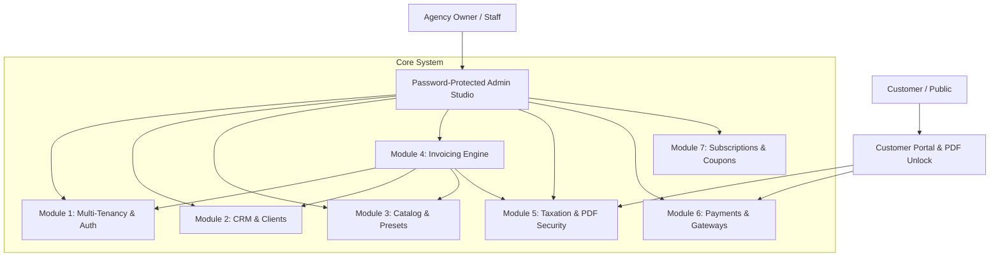

# Apex Invoice Studio — Modular Architecture & Repository Guide

Apex Invoice Studio is engineered using a modular, decoupled domain architecture designed for high maintainability, strict multi-tenancy, and seamless deployment on **Hostinger Premium Web Hosting**.

---

## Architecture Overview

---

## Module Breakdown

### Module 1: Multi-Tenancy & Authentication (`Auth & Tenancy`)
- **Responsibilities**: Isolated agency workspaces, tenant scoped queries, user login with Bcrypt protection, RBAC roles (`owner`, `admin`, `staff`), and 2FA capability.
- **Key Files**:
  - `database/migrations/2026_01_01_000001_create_workspaces_and_users_table.php`
  - `app/Models/Workspace.php`
  - `app/Models/User.php`
  - `app/Models/Scopes/WorkspaceScope.php`
  - `app/Models/Traits/BelongsToWorkspace.php`
  - `app/Http/Controllers/AuthController.php`
  - `resources/views/auth/login.blade.php`
  - `resources/views/auth/register.blade.php`

---

### Module 2: Client Directory & CRM (`CRM & Clients`)
- **Responsibilities**: Customer directory management, company profiles, VAT/tax registration IDs, country-specific currency preferences, payment terms (`net_14`, `due_on_receipt`), and tax-exemption rules.
- **Key Files**:
  - `database/migrations/2026_01_01_000004_create_clients_and_services_table.php` (Clients schema)
  - `app/Models/Client.php`
  - `app/Livewire/ClientDirectory.php`
  - `resources/views/livewire/client-directory.blade.php`
  - `resources/views/clients/index.blade.php`

---

### Module 3: Service Catalog & Industry Presets (`Catalog & Presets`)
- **Responsibilities**: Custom workspace service management with units and rates, plus 1-click auto-importing pre-configured industry service catalogs (Web Development, SMM, Apparel/Digitizing, Branding, Consulting).
- **Key Files**:
  - `app/Models/Service.php`
  - `app/Models/IndustryPreset.php`
  - `app/Models/PresetItem.php`
  - `database/seeders/IndustryPresetsSeeder.php`
  - `app/Livewire/ServiceCatalog.php`
  - `resources/views/livewire/service-catalog.blade.php`
  - `resources/views/services/index.blade.php`

---

### Module 4: Invoicing Engine & Sequential Locking (`Invoicing Engine`)
- **Responsibilities**: Concurrency-safe sequential invoice numbering (`INV-YYYY-0001`), line-item calculations, historical client/workspace immutability snapshots, and reactive invoice builder UI.
- **Key Files**:
  - `database/migrations/2026_01_01_000005_create_invoices_and_items_table.php`
  - `app/Models/Invoice.php`
  - `app/Models/InvoiceItem.php`
  - `app/Models/InvoiceSequence.php`
  - `app/Services/InvoiceNumberService.php`
  - `app/Livewire/InvoiceBuilder.php`
  - `resources/views/livewire/invoice-builder.blade.php`
  - `resources/views/invoices/index.blade.php`
  - `resources/views/invoices/create.blade.php`
  - `resources/views/invoices/show.blade.php`

---

### Module 5: Country Taxation & PDF Security (`Taxation & PDF Security`)
- **Responsibilities**: Pre-tax discount deductions (GAAP/IFRS standard), multi-country tax presets (US Sales Tax, UK VAT 20%, DE MwSt 19%, AE VAT 5%, SA VAT 15%, etc.), encrypted customer PDF password challenge, and printable PDF templates.
- **Key Files**:
  - `app/Services/TaxCalculationService.php`
  - `app/Services/PdfSecurityService.php`
  - `resources/views/invoices/pdf-challenge.blade.php`
  - `resources/views/invoices/pdf-template.blade.php`

---

### Module 6: Payments, Gateways & Webhooks (`Payments & Webhooks`)
- **Responsibilities**: Dual payment integration (Stripe & PayPal), client "Pay Now" portal, idempotent ledger recording preventing duplicate webhook billing, and credit notes tracking.
- **Key Files**:
  - `database/migrations/2026_01_01_000006_create_payments_and_credit_notes_table.php`
  - `app/Models/Payment.php`
  - `app/Models/CreditNote.php`
  - `app/Services/PaymentReconciliationService.php`
  - `app/Http/Controllers/PaymentController.php`
  - `app/Http/Controllers/WebhookController.php`
  - `resources/views/invoices/customer-portal.blade.php`

---

### Module 7: SaaS Subscriptions & Atomic Coupons (`Subscriptions & Coupons`)
- **Responsibilities**: Multi-tiered agency plans (Free Trial, Starter, Pro, Agency), atomic coupon redemption engine preventing concurrent race conditions, currency restrictions, and workspace single-use enforcement.
- **Key Files**:
  - `database/migrations/2026_01_01_000002_create_plans_and_subscriptions_table.php`
  - `database/migrations/2026_01_01_000003_create_coupons_and_redemptions_table.php`
  - `app/Models/Plan.php`
  - `app/Models/Subscription.php`
  - `app/Models/Coupon.php`
  - `app/Models/CouponRedemption.php`
  - `app/Services/CouponService.php`
  - `database/seeders/PlanSeeder.php`
  - `database/seeders/CouponSeeder.php`
  - `app/Livewire/MembershipCheckout.php`
  - `resources/views/livewire/membership-checkout.blade.php`
  - `resources/views/membership/index.blade.php`

---

### Module 8: Hostinger Deployment & System Configuration (`Hostinger Deployment`)
- **Responsibilities**: LiteSpeed cache exclusion rules, front-controller rewrite rules, shared hosting security barriers, zero-build asset pipelining, and deployment automation scripts.
- **Key Files**:
  - `HOSTINGER_DEPLOYMENT_GUIDE.md`
  - `.htaccess`
  - `public/.htaccess`
  - `public/index.php`
  - `bootstrap/app.php`
  - `composer.json`
  - `.env.example`
  - `artisan`
  - `app/Http/Controllers/DashboardController.php`
  - `resources/views/dashboard.blade.php`
  - `resources/views/layouts/app.blade.php`
  - `resources/views/layouts/guest.blade.php`
  - `routes/web.php`
