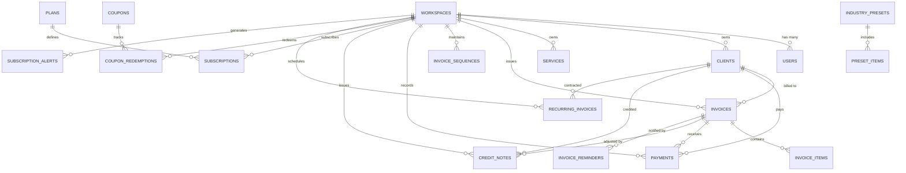

# Database Schema Reference
## Project: Invoicy by RedMaple — Multi-Tenant SaaS Database Architecture

**Document Version:** 2.0.0  
**Status:** Approved & Live in Production  
**Database Engine:** MySQL 8.0+ / MariaDB 10.11+ (InnoDB Engine, `utf8mb4_unicode_ci`)  

---

## 1. Entity-Relationship Diagram (ERD)

---

## 2. Core Tenancy & User Accounts

### 2.1 `workspaces`
Tenant boundary table representing an agency or business account.

| Column | Type | Nullable | Default | Description & Constraints |
| :--- | :--- | :--- | :--- | :--- |
| `id` | `CHAR(36)` | NO | UUID v4 | Primary Key |
| `name` | `VARCHAR(255)` | NO | - | Agency business name |
| `slug` | `VARCHAR(255)` | NO | - | Unique tenant slug URL identifier (`UNIQUE`) |
| `logo_url` | `VARCHAR(255)` | YES | NULL | S3 or local path to uploaded logo |
| `brand_color` | `VARCHAR(7)` | NO | `#dc2626` | Primary brand color hex code |
| `secondary_color` | `VARCHAR(7)` | NO | `#1e293b` | Secondary brand color hex code |
| `currency` | `VARCHAR(3)` | NO | `USD` | Default 3-letter ISO currency code |
| `language` | `VARCHAR(5)` | NO | `en` | Default workspace language code |
| `country_code` | `VARCHAR(2)` | NO | `US` | ISO 3166-1 alpha-2 country code |
| `tax_id` | `VARCHAR(50)` | YES | NULL | Company VAT / GST / Tax registration ID |
| `address` | `TEXT` | YES | NULL | Registered legal business address |
| `phone` | `VARCHAR(50)` | YES | NULL | Agency contact phone number |
| `email` | `VARCHAR(255)` | YES | NULL | Agency contact email address |
| `website` | `VARCHAR(255)` | YES | NULL | Company website URL |
| `bank_details` | `JSON` | YES | NULL | Bank wire transfer remittance details |
| `stripe_keys_encrypted` | `TEXT` | YES | NULL | AES-256-CBC encrypted Stripe credentials |
| `paypal_keys_encrypted` | `TEXT` | YES | NULL | AES-256-CBC encrypted PayPal credentials |
| `smtp_settings_encrypted` | `TEXT` | YES | NULL | AES-256-CBC encrypted custom SMTP settings |
| `is_whitelabel_enabled` | `TINYINT(1)`| NO | `0` | Whether agency whitelabel mode is active |
| `created_at` / `updated_at` | `TIMESTAMP` | YES | NULL | Standard Laravel timestamps |

### 2.2 `users`
Authenticated agency staff, owners, and platform super administrators.

| Column | Type | Nullable | Default | Description & Constraints |
| :--- | :--- | :--- | :--- | :--- |
| `id` | `BIGINT UNSIGNED` | NO | AUTO_INC | Primary Key |
| `workspace_id` | `CHAR(36)` | YES | NULL | Foreign Key -> `workspaces.id` (`ON DELETE CASCADE`) |
| `name` | `VARCHAR(255)` | NO | - | User full name |
| `email` | `VARCHAR(255)` | NO | - | Unique user login email (`UNIQUE`) |
| `email_verified_at` | `TIMESTAMP` | YES | NULL | Email verification timestamp |
| `password` | `VARCHAR(255)` | NO | - | Bcrypt hashed user password |
| `role` | `ENUM` | NO | `owner` | RBAC role: `owner`, `admin`, `staff` |
| `is_super_admin` | `TINYINT(1)` | NO | `0` | Platform super admin privilege flag (`INDEX`) |
| `two_factor_secret` | `TEXT` | YES | NULL | 2FA encrypted TOTP secret |
| `two_factor_recovery_codes`| `TEXT` | YES | NULL | 2FA recovery backup codes |
| `two_factor_confirmed_at`| `TIMESTAMP` | YES | NULL | 2FA activation timestamp |
| `remember_token` | `VARCHAR(100)` | YES | NULL | Persistent login token |
| `created_at` / `updated_at` | `TIMESTAMP` | YES | NULL | Standard Laravel timestamps |

---

## 3. SaaS Subscription & Coupon Tables

### 3.1 `plans`
SaaS subscription tiers and feature rule constraints.

| Column | Type | Nullable | Default | Description |
| :--- | :--- | :--- | :--- | :--- |
| `id` | `BIGINT UNSIGNED` | NO | AUTO_INC | Primary Key |
| `name` | `VARCHAR(255)` | NO | - | Plan display name (e.g., Starter Agency) |
| `code` | `VARCHAR(50)` | NO | - | Unique system code (`trial`, `starter`, `pro`, `enterprise`) |
| `price_cents` | `INT` | NO | `0` | Monthly subscription price in integer cents |
| `currency` | `VARCHAR(3)` | NO | `USD` | 3-letter currency code |
| `billing_interval` | `VARCHAR(20)` | NO | `month` | Billing cycle: `month` or `year` |
| `invoice_limit` | `INT` | NO | `-1` | Maximum monthly invoices allowed (-1 = unlimited) |
| `client_limit` | `INT` | NO | `-1` | Maximum saved clients allowed (-1 = unlimited) |
| `team_seats` | `INT` | NO | `1` | Maximum team member seats allowed |
| `has_whitelabel` | `TINYINT(1)` | NO | `0` | Whitelabel invoicing feature permission |
| `has_client_portal` | `TINYINT(1)` | NO | `1` | Interactive customer portal permission |
| `has_recurring` | `TINYINT(1)` | NO | `0` | Automated recurring retainers permission |
| `features_json` | `JSON` | YES | NULL | List of marketing feature bullet points |
| `is_active` | `TINYINT(1)` | NO | `1` | Whether plan is available for selection |

### 3.2 `subscriptions`
Tenant active contracts, subscription statuses, and renewal periods.

| Column | Type | Nullable | Default | Description |
| :--- | :--- | :--- | :--- | :--- |
| `id` | `CHAR(36)` | NO | UUID v4 | Primary Key |
| `workspace_id` | `CHAR(36)` | NO | - | Foreign Key -> `workspaces.id` (`INDEX`) |
| `plan_id` | `BIGINT UNSIGNED`| NO | - | Foreign Key -> `plans.id` |
| `gateway` | `VARCHAR(50)` | NO | `trial` | Payment method: `trial`, `stripe`, `paypal`, `manual_admin` |
| `gateway_subscription_id`| `VARCHAR(255)` | YES | NULL | External gateway subscription reference |
| `gateway_customer_id` | `VARCHAR(255)` | YES | NULL | External gateway customer reference |
| `status` | `VARCHAR(50)` | NO | `trialing` | Status: `active`, `trialing`, `suspended`, `inactive`, `canceled`, `expired` |
| `trial_ends_at` | `TIMESTAMP` | YES | NULL | 14-day trial expiration timestamp |
| `current_period_ends_at` | `TIMESTAMP` | YES | NULL | Subscription expiration / renewal timestamp |
| `canceled_at` | `TIMESTAMP` | YES | NULL | Cancellation timestamp |

### 3.3 `coupons` & `coupon_redemptions`
Atomic discount engine supporting fixed and percentage promotions.

| Table | Key Columns | Description |
| :--- | :--- | :--- |
| `coupons` | `id`, `code`, `discount_type` (`percent`/`fixed`), `discount_value`, `max_redemptions`, `redemptions_count`, `expires_at`, `is_active` | Promotional discount rules. `code` is indexed unique. |
| `coupon_redemptions` | `id`, `coupon_id`, `workspace_id`, `original_amount_cents`, `discount_amount_cents`, `redeemed_at` | Audit ledger tracking coupon usage per workspace. |

---

## 4. CRM & Invoicing Tables

### 4.1 `clients`
Customer address, language, and billing preferences.

| Column | Type | Nullable | Description |
| :--- | :--- | :--- | :--- |
| `id` | `CHAR(36)` | NO | Primary Key (UUID v4) |
| `workspace_id` | `CHAR(36)` | NO | Foreign Key -> `workspaces.id` (`INDEX`) |
| `name` | `VARCHAR(255)` | NO | Client contact name |
| `company_name` | `VARCHAR(255)` | YES | Business / Legal company name |
| `email` | `VARCHAR(255)` | NO | Invoice recipient email |
| `phone` | `VARCHAR(50)` | YES | Phone number (also used for PDF PIN challenge) |
| `tax_id` | `VARCHAR(50)` | YES | Client VAT / Tax registration ID |
| `address`, `city`, `state`, `postal_code`, `country_code` | `VARCHAR` | YES | Complete physical billing address |
| `preferred_currency` | `VARCHAR(3)` | NO | Preferred currency (e.g. `USD`, `GBP`, `EUR`, `AED`, `PKR`) |
| `preferred_language` | `VARCHAR(5)` | NO | Preferred language code (e.g. `en`, `ur`, `ar`, `hi`, `tr`) |
| `default_payment_terms` | `VARCHAR(20)`| NO | Terms: `due_on_receipt`, `net_7`, `net_14`, `net_30`, `net_60` |
| `is_tax_exempt` | `TINYINT(1)` | NO | If `1`, taxes are excluded from invoice calculations |
| `deleted_at` | `TIMESTAMP` | YES | Soft deletes support |

### 4.2 `invoices` & `invoice_items`
Core invoicing transactions, calculation snapshots, and sequential tracking.

| Table | Key Columns | Description |
| :--- | :--- | :--- |
| `invoices` | `id`, `workspace_id`, `client_id`, `invoice_number` (`UNIQUE`), `status` (`draft`, `issued`, `partially_paid`, `paid`, `overdue`, `cancelled`), `issue_date`, `due_date`, `currency`, `subtotal_cents`, `discount_cents`, `tax_cents`, `total_cents`, `paid_cents`, `due_cents`, `security_pin`, `client_snapshot_json`, `workspace_snapshot_json` | Complete invoice ledger record with frozen historical snapshots. |
| `invoice_items` | `id`, `invoice_id`, `description`, `quantity`, `unit_price_cents`, `tax_rate`, `subtotal_cents`, `total_cents`, `sort_order` | Individual line items. Amounts calculated strictly in integer cents. |
| `invoice_sequences` | `id`, `workspace_id`, `year`, `current_sequence` | Counter table locked via `SELECT ... FOR UPDATE` during generation. |

### 4.3 `payments` & `credit_notes`
Payment reconciliation and ledger adjustments.

| Table | Key Columns | Description |
| :--- | :--- | :--- |
| `payments` | `id`, `workspace_id`, `invoice_id`, `client_id`, `payment_number`, `gateway`, `amount_cents`, `currency`, `gateway_transaction_id`, `idempotency_key`, `status` (`completed`) | Idempotent transaction ledger. Duplicate webhooks with same key are ignored. |
| `credit_notes` | `id`, `workspace_id`, `invoice_id`, `client_id`, `credit_note_number`, `amount_cents`, `reason`, `status` (`issued`, `applied`) | Official accounting refund/credit adjustment. Soft-deletion is prohibited. |

---

## 5. Automation, CMS & Platform Tables

| Table | Purpose & Structure |
| :--- | :--- |
| `invoice_reminders` | Tracks automated dunning reminders dispatched (`invoice_id`, `stage`, `sent_at`, `recipient_email`). |
| `recurring_invoices` | Retainer schedules (`client_id`, `frequency`, `next_run_date`, `status`, `auto_send`). |
| `cms_contents` | System-wide configuration key-value store (`admin_alert_email`, `alert_on_signup`, `system_logo_url`). |
| `doc_articles` | Multilingual software documentation articles (`category`, `title_json`, `content_json`, `slug`). |
| `advertisements` | Sponsor ads (`title`, `headline`, `image_url`, `destination_url`, `position`, `clicks_count`). |
| `website_pages` | Public custom pages (`title`, `slug`, `content_html`, `show_in_footer`, `is_published`). |
| `subscription_alerts` | Super admin notification queue (`type`, `title`, `message`, `metadata`, `is_read`, `email_sent`). |
