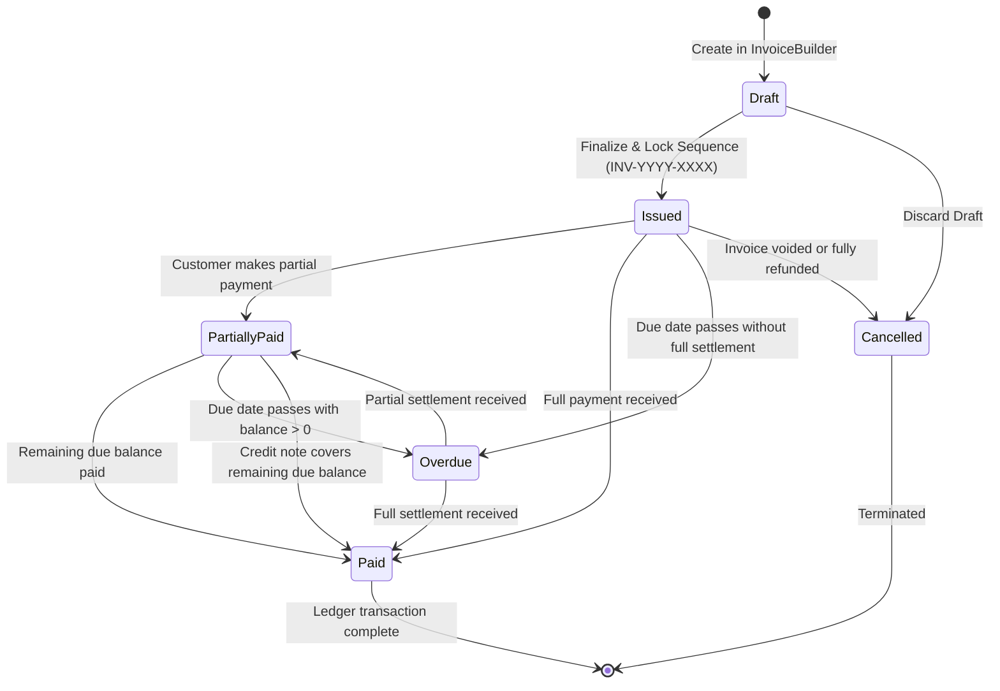
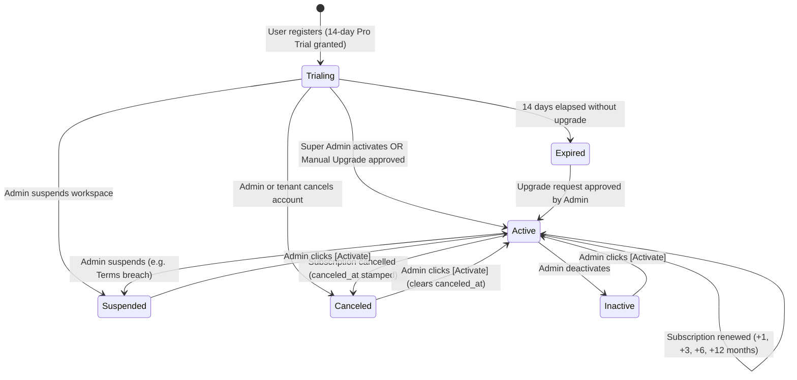
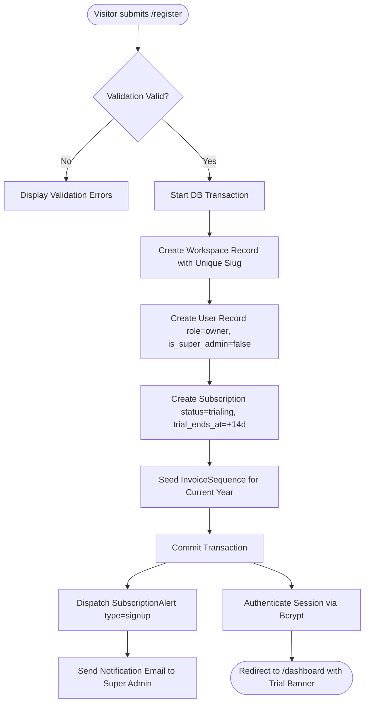
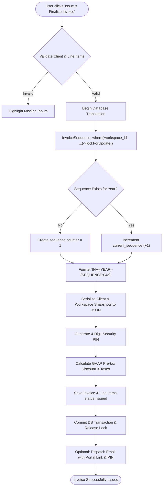
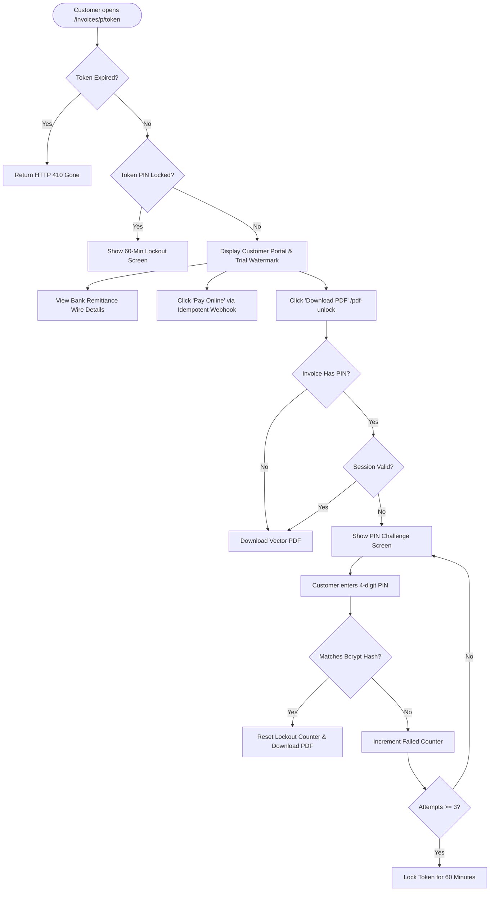
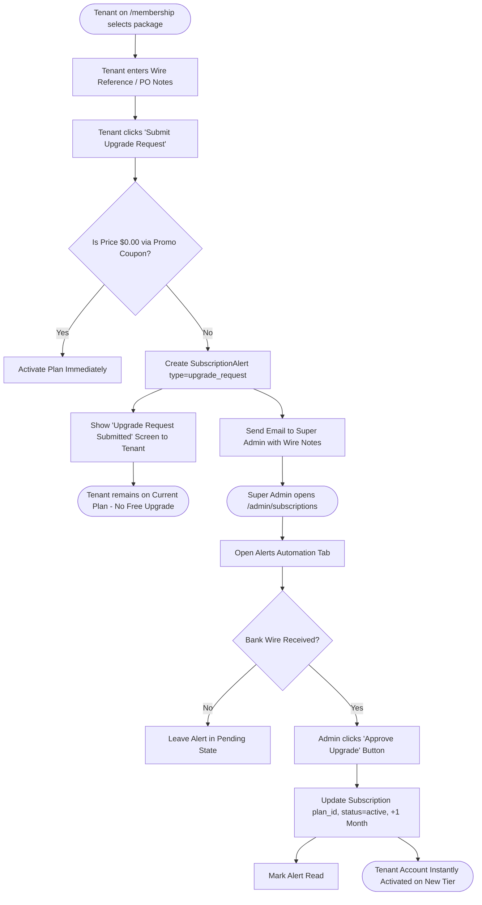
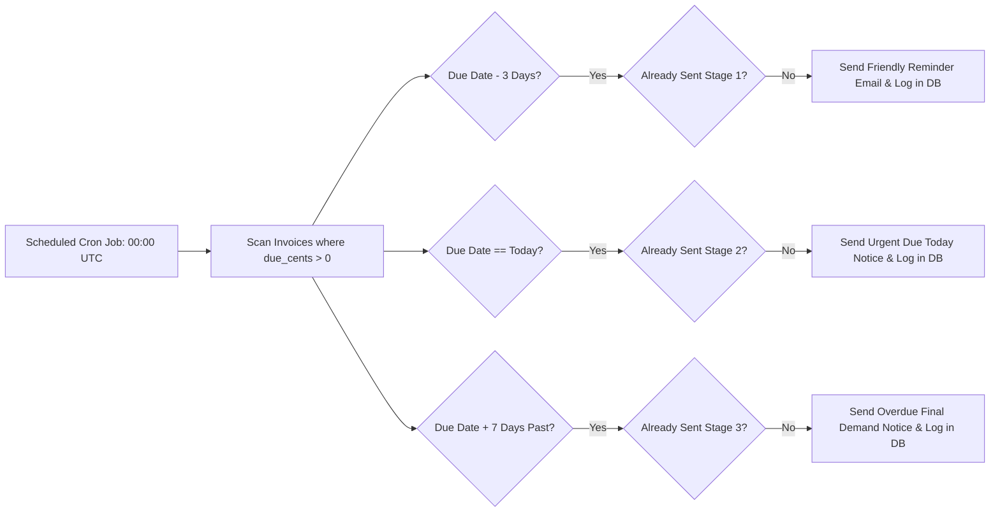
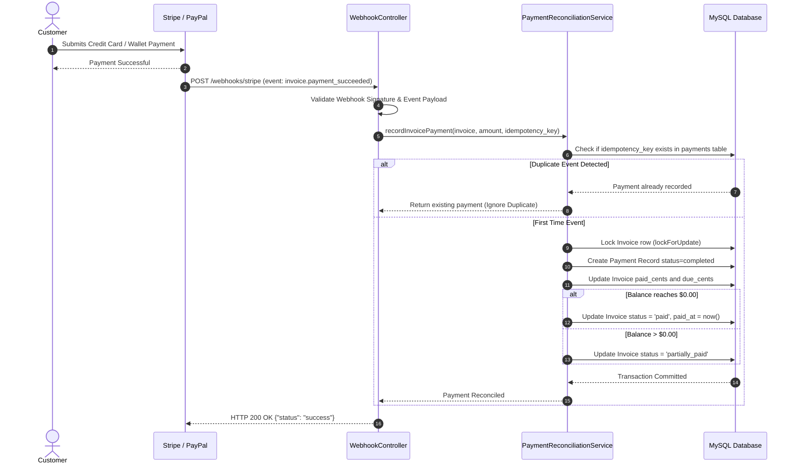
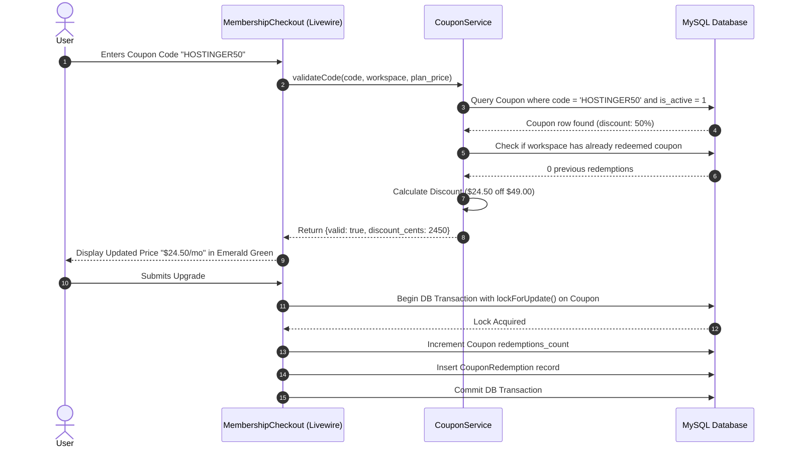

# Visual Application Flow Diagrams (VISUAL_APPFLOW.md)
## Project: Invoicy by RedMaple — Comprehensive Architecture & State Flows

**Document Version:** 2.0.0  
**Status:** Approved & Live in Production  
**Format:** Native Mermaid Architecture Diagrams  

---

## 1. Invoice Transaction Lifecycle State Machine

---

## 2. Tenant Subscription Lifecycle State Machine

---

## 3. User Registration & Provisioning Pipeline

---

## 4. Concurrency-Safe Invoice Creation & Locking Flow

---

## 5. Customer Portal & PIN Challenge Flow

---

## 6. Option B: Manual Upgrade Request & Admin Approval Flow

---

## 7. Automated 3-Stage Dunning Reminder Engine

---

## 8. Webhook Payment Reconciliation Sequence

---

## 9. Atomic Coupon Validation & Checkout Sequence

